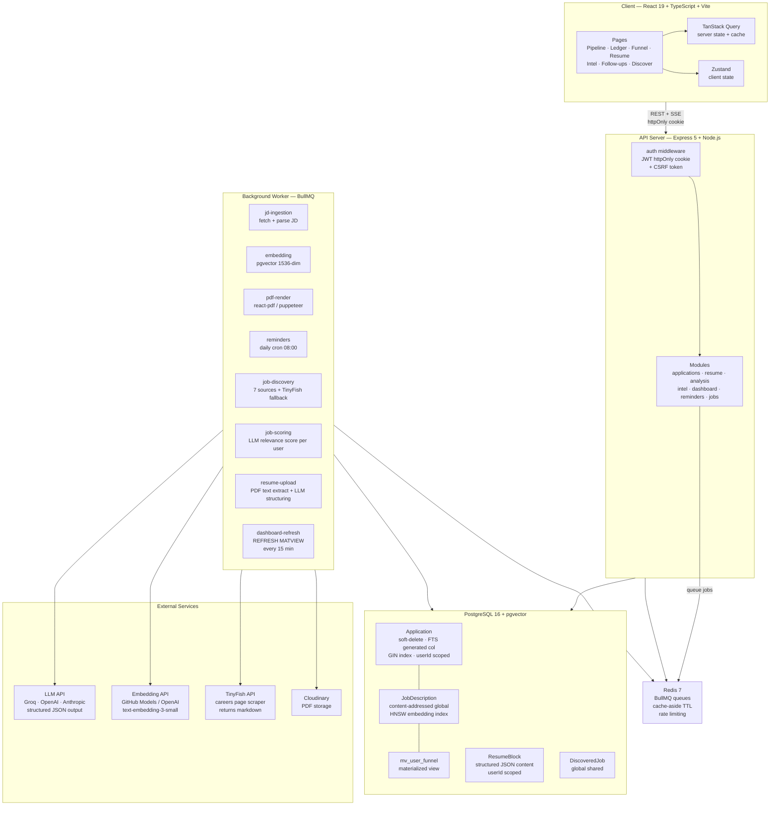

# Pursuit

Full-stack job-hunt command center. Tracks applications, runs AI gap analysis + resume tailoring per JD, discovers openings from 271 companies on demand (12h cache), surfaces intelligence across your history.

---

## Architecture


<details>
<summary>Detailed diagram</summary>



</details>

---

## How It Works

### Application Pipeline
Add a job by URL or pasted JD (required). Worker parses it into structured fields and a 1536-dim embedding. Kanban: SAVED → APPLIED → OA → TECH → HR → OFFER.

### AI Analysis
Three on-demand analyses per application, streamed over SSE:

| Analysis | What it does |
|----------|-------------|
| **Gap** | Resume vs JD — matched/missing/partial skills + 0–100 fit score |
| **Prep** | Technical, behavioral, gap-probe interview questions |
| **Tailor** | Rewrites resume bullets to mirror JD language, facts stay truthful |

### Job Discovery
On demand (`POST /jobs/refresh`, 12h cache). Seven ATS/board sources plus TinyFish for companies with no ATS id. TinyFish drops markup and non-role titles. Wellfound is off. `GET /jobs` is cursor-paginated (50). Each user scores relevance against their own resume.

### Resume Upload
Drag-and-drop a PDF on `/resume`. Server extracts text, worker sends it to the LLM to structure into typed blocks (EXPERIENCE/PROJECTS/SKILLS/EDUCATION), appended to existing blocks. Page polls and auto-refreshes on completion.

### Intelligence
After one structured JD, the Intel page shows:
- **Skill demand** — most-requested skills across your JDs
- **Gap frequency** — skills most often missing from your resume
- **Job clusters** — greedy groups of embeddings with cosine ≥ 0.7 (not k-means)
- **Similar jobs** — HNSW nearest-neighbor search per JD

### Dashboard
Funnel occupancy (current mix across stages, not path conversion), weekly velocity, LLM cost tracking. Stage counts from live applications. Responses Redis-cached (15 min TTL), invalidated on create, stage change, and delete.

---

## Local Setup

### Prerequisites
- Node.js 20+
- Docker (for Postgres + Redis)
- An LLM API key — [Groq](https://console.groq.com) is free and fast
- Optional: [TinyFish](https://tinyfish.ai) API key for the careers-page fallback on companies without an ATS id

### 1. Clone and install

```bash
git clone https://github.com/AdityaKrSingh26/Pursuit.git
cd Pursuit
npm install
npm --prefix server install
npm --prefix client install
```

### 2. Configure environment

```bash
cp .env.example .env
```

Fill in `.env`:

```bash
# Required
JWT_SECRET=<random 32-char string>
LLM_API_KEY=<your Groq or OpenAI key>

# For job discovery
TINYFISH_API_KEY=<from tinyfish.ai — free>

# For embeddings (GitHub Models PAT or OpenAI key)
EMBEDDING_API_KEY=<github PAT or openai key>
```

### 3. Start infrastructure

```bash
docker compose up -d
```

### 4. Run migrations

```bash
npx prisma migrate deploy
npx prisma migrate dev
npx prisma generate
```

Prisma 7 reads `prisma.config.ts` at the repo root. Do not run Prisma with `--prefix server`. Use `migrate deploy` against a hosted database (Neon). `migrate dev` is for a local Postgres you are iterating on.

### 5. Start all three processes

```bash
# Terminal 1 — API server
npm --prefix server run dev

# Terminal 2 — background worker
npm --prefix server run dev:worker

# Terminal 3 — frontend
npm --prefix client run dev
```

Open [http://localhost:5173](http://localhost:5173), register an account, and start tracking.

---

## Project Structure

```
Pursuit/
├── client/                   # React frontend
│   └── src/
│       ├── features/         # Page-level components
│       │   ├── applications/ # Pipeline kanban + list + detail drawer
│       │   ├── resume/       # Structured block editor with DnD
│       │   ├── dashboard/    # Funnel + velocity + cost charts
│       │   ├── intel/        # Skill demand, gap frequency, clusters
│       │   ├── jobs/         # Job discovery + relevance scoring
│       │   └── reminders/    # Follow-up nudges
│       ├── components/       # Shared UI (Button, Modal, Tag, etc.)
│       └── lib/              # API client, TanStack Query hooks, types
│
├── server/
│   └── src/
│       ├── modules/          # Feature modules (router + service per domain)
│       │   ├── applications/
│       │   ├── resume/
│       │   ├── analysis/     # GAP · PREP · TAILOR via SSE
│       │   ├── dashboard/
│       │   ├── intel/
│       │   ├── jobs/         # Discovery + scoring
│       │   └── reminders/
│       ├── jobs/             # BullMQ workers
│       │   ├── ingestion/    # JD fetch + parse
│       │   ├── embedding/    # pgvector embeddings
│       │   ├── pdf/          # PDF render
│       │   ├── reminders/    # Daily follow-up scan
│       │   ├── discovery/    # 7 job sources + optional TinyFish fallback; Wellfound off
│       │   ├── scoring/      # Per-user LLM relevance scoring
│       │   └── resumeUpload/ # PDF text extraction + LLM structuring
│       ├── lib/              # db · redis · llm · cache · jwt · env
│       ├── prompts/          # LLM prompt builders
│       └── middleware/       # auth (JWT) · csrf · rate-limit
│
├── prisma/
│   ├── schema.prisma         # 10 models, tenant via userId in queries
│   └── migrations/
│
├── evals/                    # LLM prompt evaluation suite
└── docker-compose.yml        # Postgres 16 + pgvector, Redis 7
```

---

## Environment Variables

| Variable | Required | Description |
|----------|----------|-------------|
| `DATABASE_URL` | Yes | PostgreSQL connection string |
| `REDIS_URL` | Yes | Redis connection string |
| `JWT_SECRET` | Yes | Access token signing key (min 16 chars, HS256) |
| `LLM_PROVIDER` | Yes | `openai` or `anthropic` |
| `LLM_API_KEY` | Yes | API key for your LLM provider |
| `LLM_API_KEYS` | No | Comma-separated list of keys to rotate through on HTTP 429 for both OpenAI-compatible and Anthropic (falls back to `LLM_API_KEY`) |
| `LLM_BASE_URL` | No | Custom base URL (e.g. Groq: `https://api.groq.com/openai/v1`) |
| `LLM_MODEL` | No | Groq: `openai/gpt-oss-120b`. Unset default: `claude-sonnet-4-6` |
| `LLM_MAX_TOKENS` | No | Max tokens per LLM call (default: 2000) |
| `EMBEDDING_API_KEY` | Yes* | API key for embeddings (*required when using custom LLM base URL) |
| `EMBEDDING_BASE_URL` | No | Embedding endpoint (default: OpenAI) |
| `EMBEDDING_MODEL` | No | Embedding model (default: `text-embedding-3-small`) |
| `TINYFISH_API_KEY` | No | [TinyFish](https://tinyfish.ai) key for the careers-page scrape fallback |
| `ADZUNA_APP_ID` | No | [Adzuna](https://developer.adzuna.com) app ID, one of the job discovery sources |
| `ADZUNA_APP_KEY` | No | Adzuna app key |
| `CLOUDINARY_CLOUD_NAME` | No | Cloudinary for PDF uploads |
| `CLOUDINARY_API_KEY` | No | Cloudinary API key |
| `CLOUDINARY_API_SECRET` | No | Cloudinary API secret |
| `PORT` | No | API port (default: 3001) |
| `REMINDER_DAYS_THRESHOLD` | No | Days of silence before a follow-up reminder (default: 7) |

---

## Scripts

From the repo root:

| Command | What it runs |
|---------|----------------|
| `npm run lint` | ESLint on the server **and** the client |
| `npm run typecheck` | TypeScript check on the client. The API stays JavaScript. |
| `npm run test` | Server Vitest suite |
| `npm run evals` | LLM prompt evals (needs a live key and database) |
